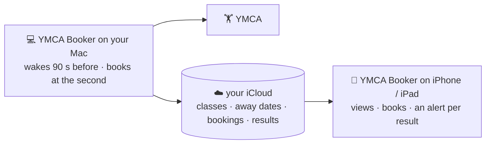
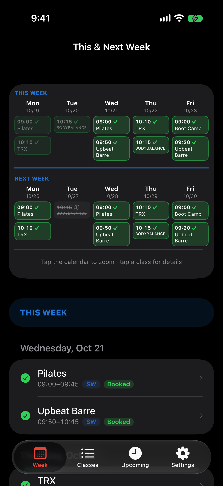
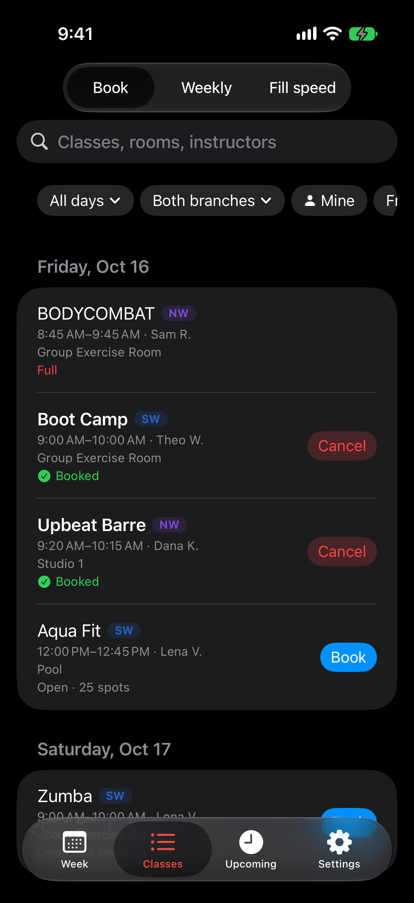
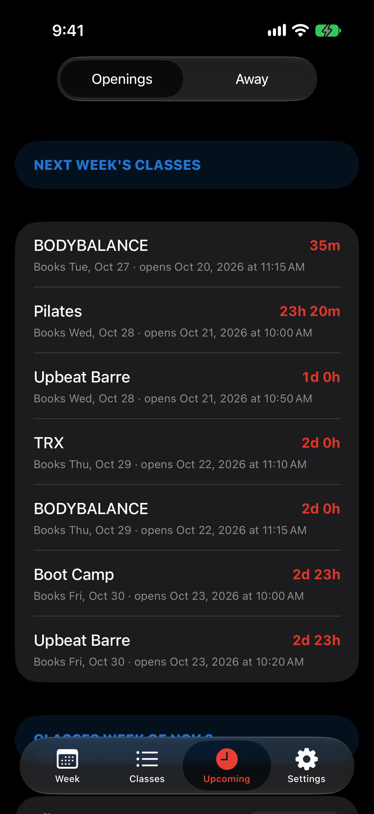
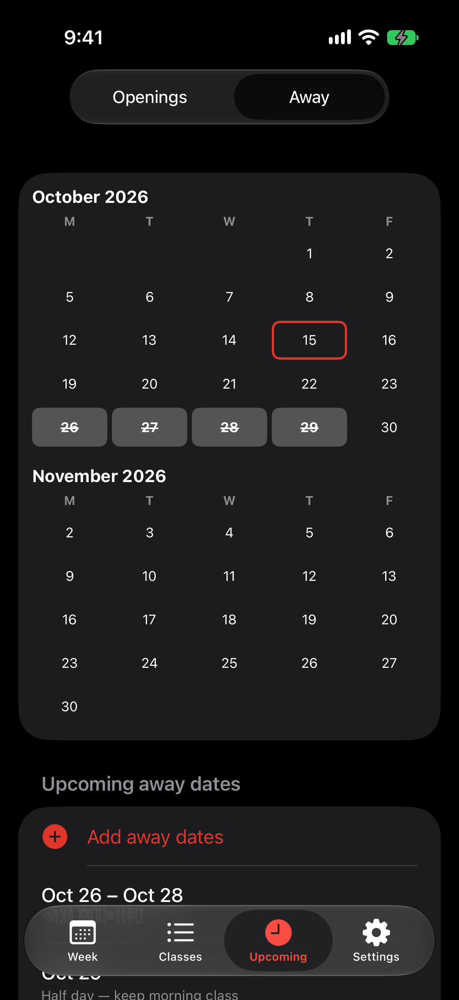
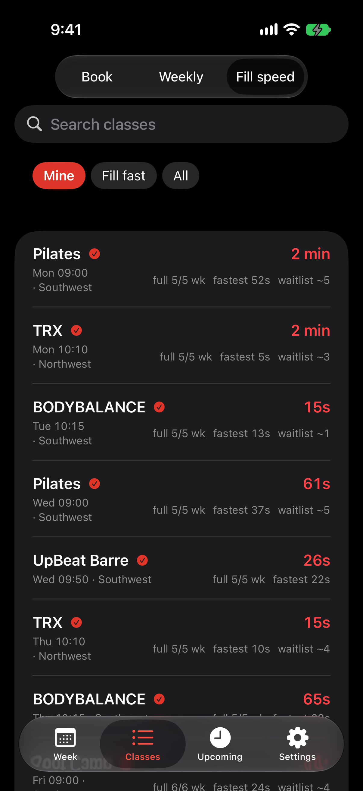
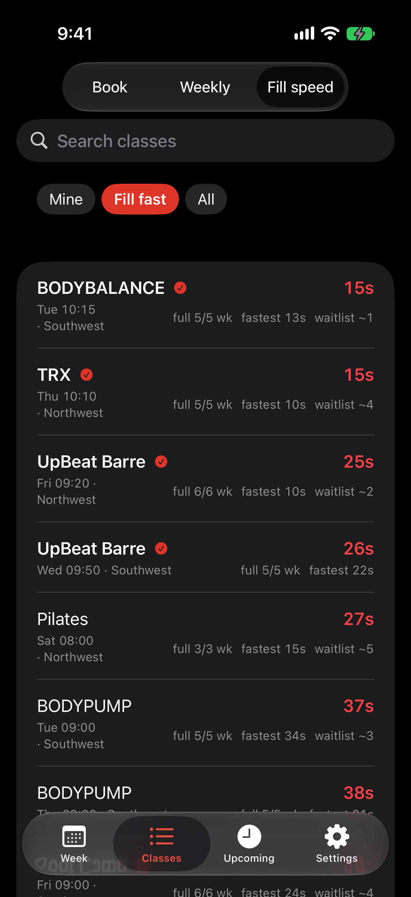

# ymca-autobook

Books your recurring YMCA of Silicon Valley classes the second they open.

A class opens for booking **167 hours before it starts** (a Thursday 10:15 class opens
the Thursday before at 11:15). Popular ones fill in under a minute, so the **YMCA
Booker** app on your Mac waits for that exact second and books it. The same app on
your iPhone or iPad shows your schedule and tells you each result.

## What you need

- **A Mac that stays on and awake** when classes open. A desktop (iMac, Mac mini,
  Mac Studio) is best; a MacBook only books while it's open, awake and online.
- **An iCloud account**, the same one on the Mac and the iPhone or iPad.
- **Your YMCA login** (the egym email and password you use for the YMCA app).

No GitHub account, token or server. Everything stays on your Mac and in your iCloud.

## Set it up

1. **On the Mac:** install **YMCA Booker** (see [Installing](#installing)) and open it.
2. In its Settings, **log in with your YMCA account**.
3. Under **Browse**, add the classes you want every week. Each one books from then on.
4. **On the iPhone or iPad:** install **YMCA Booker**, signed in to the same iCloud,
   and allow notifications.

To skip a day, add it under **Away**. To book or skip one session, use **Book**.

**Keep the Mac awake:** plug it in and turn on System Settings → Energy → *Prevent
automatic sleeping*. If the Mac is asleep, off or its lid is closed when a class opens,
that class isn't booked.

## How it works

The Mac plans every few hours, wakes just before each window, and books at the exact
second. It publishes your lineup, away dates, bookings and results to your private
iCloud. The phone reads them, and anything you book or change on the phone is sent
to the Mac to do.

## The app

| Week | Classes | Book | Openings | Away |
|:---:|:---:|:---:|:---:|:---:|
|  |  |  |  |  |

- **Week**: two weeks of classes; green ✓ means actually booked.
- **Classes**: your weekly lineup as a calendar and a list, with how fast each class fills.
- **Book**: every upcoming class at all nine YMCA of Silicon Valley branches. Book or
  cancel any one; filter by day, branches (pick any number), start time, and hide pool
  or paid classes.
- **Openings**: countdowns to each booking window, the Mac's status and each booking
  result (with GitHub, a **Book now** swipe instead).
- **Away**: away dates (add, edit, delete) and one-off swaps.

### Fill speed

| Mine | Fill fast |
|:---:|:---:|
|  |  |

How long every class at every branch takes to fill once booking opens, over the
last 12 weeks. BODYPUMP fills in ~37 seconds every week; most classes take hours or
never fill.

- **Week**: two weeks of classes; a green ✓ means actually booked.
- **Classes**: your weekly lineup, and how fast each class fills.
- **Book**: every upcoming class at all nine branches. Book or cancel any one; filter
  by day, branches, start time, pool and paid classes.
- **Openings**: countdowns to each booking window and each booking result.
- **Away**: days off (add, edit, delete) and one-off swaps.

**Fill speed** shows how long each class at every branch takes to fill once booking
opens, over the last 12 weeks. BODYPUMP fills in about 37 seconds; most classes take
hours or never fill.

| Mine | Fill fast |
|:---:|:---:|
|  |  |

_Screenshots use a made-up lineup and sample data; the Fill speed numbers are real (10/10). Updated 10/20._

More on the app, its settings and how it's built: [`app/README.md`](app/README.md).

## Installing

**iPhone / iPad (TestFlight):**
1. Email **[thomashan@icloud.com](mailto:thomashan@icloud.com)** for an invite.
2. Install Apple's **[TestFlight](https://apps.apple.com/app/testflight/id899247664)** app.
3. Open the invite on your phone and tap **Install**. No Developer Mode needed.

TestFlight builds last 90 days; a new one shows up in TestFlight before then.

**Mac:** download the `.dmg` from [Releases](https://github.com/thomashan1/ymca-autobook/releases),
open it and drag **YMCA Booker** to Applications.

_Both are coming soon ([#151](https://github.com/thomashan1/ymca-autobook/issues/151)).
Until then the app is built from this repo with Xcode._

## Not done yet

- Editing the weekly classes on the iPhone ([#148](https://github.com/thomashan1/ymca-autobook/issues/148)); the Mac can.
- First-run setup, choosing your branches ([#150](https://github.com/thomashan1/ymca-autobook/issues/150)).
- A signed Mac download and TestFlight for the iPhone ([#151](https://github.com/thomashan1/ymca-autobook/issues/151)).

## Advanced: no Mac? Run it on GitHub

There's also a do-it-yourself version for technical users: GitHub Actions books in
the cloud, started on time by cron-job.org, with your plan in a private GitHub repo.
It needs no Mac but takes two repos, tokens, secrets and a cron-job.org account. It
can also run alongside the Mac as a backup.

**[Option B: GitHub setup →](docs/option-b-github.md)**
