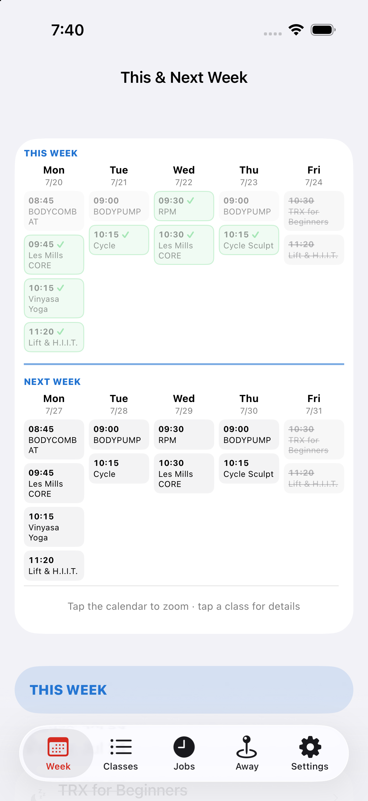
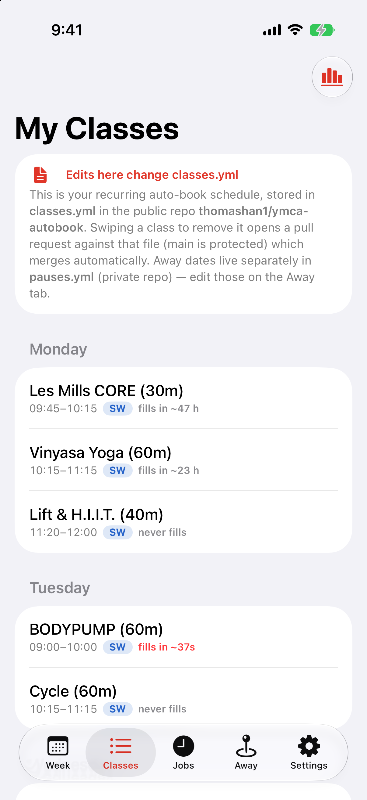
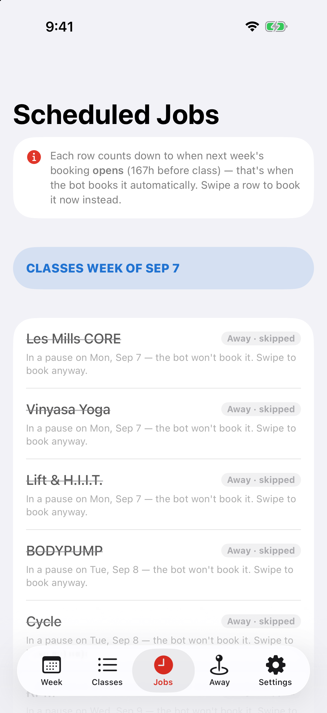
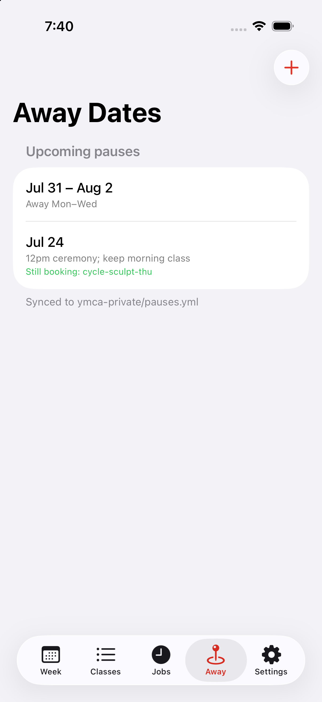
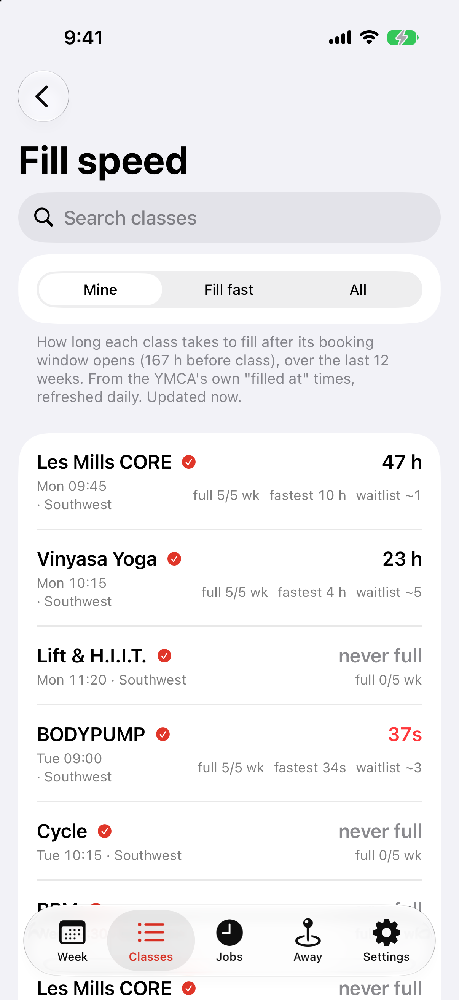
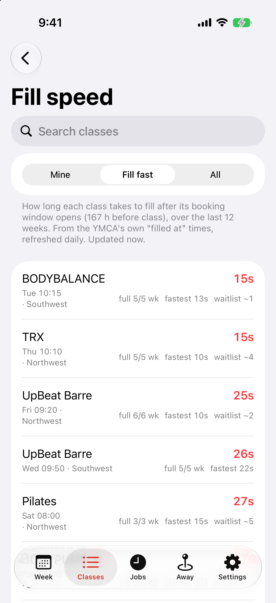
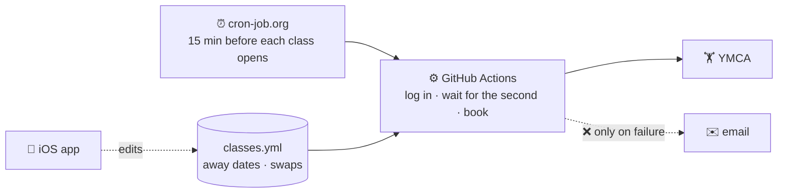
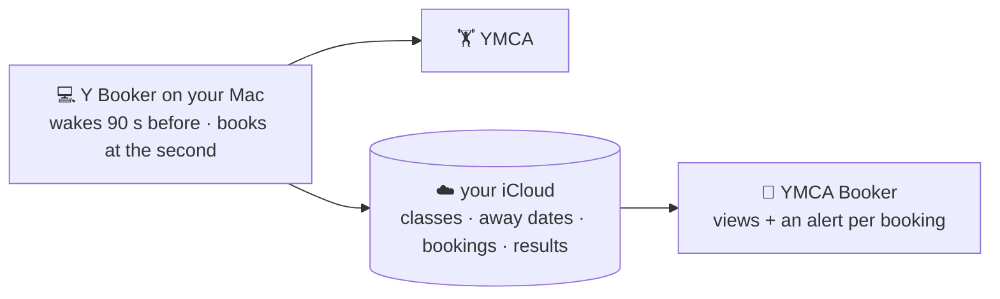

# ymca-autobook

Automatically books recurring Silicon Valley YMCA classes the second they open.

Each class opens for booking **167 hours before it starts**, i.e. a week ahead, one
hour after the class time (a Thursday 10:15 class opens the prior Thursday at 11:15).
This bot logs in just before, waits for that exact second, and books it.

## Two ways to run it

| | **Option A: GitHub** | **Option B: Mac + iPhone** |
|---|---|---|
| Who books | GitHub Actions, started by cron-job.org | The **Y Booker** app on your Mac |
| Your data | Files in two GitHub repos | Your own iCloud |
| Accounts | GitHub, cron-job.org, the YMCA | iCloud, the YMCA |
| Needs | Nothing running at home | A Mac that's on and awake |
| Works on | Any device (it's all in the cloud) | Apple only: a Mac, plus an iPhone or iPad to view |
| Status | Live since July | Live since 10/12, alongside A; not downloadable yet ([#146](https://github.com/thomashan1/ymca-autobook/issues/146)) |

Both can run at once. Right now they do: both try every class, one gets the seat,
and the other confirms the booking is yours.

## 📱 iOS app

**YMCA Booker**, in [`ios/`](ios/), shows your schedule on an iPhone or iPad. It works with
either option: pick one at the top of its Settings (**Booker: GitHub | Mac**). It doesn't
book anything itself. See [`ios/README.md`](ios/README.md).

| This & Next Week | My Classes | Scheduled Jobs | Away Dates |
|:---:|:---:|:---:|:---:|
|  |  |  |  |

- **Week**: two weeks of classes; green ✓ means actually booked.
- **Classes**: your recurring lineup and how fast each class fills.
- **Jobs**: countdowns to each booking window (with GitHub, a **Book now** swipe;
  with the Mac, its status and each booking result).
- **Away**: away dates and one-off swaps.

### Fill speed

| Mine | Fill fast |
|:---:|:---:|
|  |  |

How long every class at both branches takes to fill once booking opens, over the
last 12 weeks. BODYPUMP fills in ~37 seconds every week; most classes take hours or
never fill.

_Screenshots use sample data; the Fill speed numbers are real (10/10)._

## Option A: GitHub

### How it works



1. **cron-job.org** starts a GitHub Actions run shortly before each class's window opens.
2. The run **logs in**, finds the class, and skips it if you're away that day.
3. It **waits** for the exact opening second and **books**.
4. You get an **email only if something goes wrong**.

The full diagrams and the reasoning behind them are in
[`docs/architecture.md`](docs/architecture.md).

### Your classes

Listed in [`classes.yml`](classes.yml):

```yaml
classes:
  - key: vinyasa-yoga-mon     # short unique name
    name: "Vinyasa Yoga"      # exact title on the YMCA schedule
    weekday: Mon
    start: "10:15"
    location_ids: [1392]      # Southwest = 1392, Northwest = 1388
```

After changing it, run `.venv/bin/python scripts/gen_workflow.py` and commit both files.

### Away dates and swaps

Both live in a separate **private** repo, so they never appear here.

- **`pauses.yml`**: dates to skip, optionally keeping specific classes
  ([example](pauses.example.yml)).
- **`swaps.yml`**: on one date, take a different class instead of a recurring one
  ([example](swaps.example.yml)). Your original class is only cancelled once the
  replacement is actually booked.

### Setup

```bash
/usr/bin/python3 -m venv .venv
.venv/bin/python -m pip install -r requirements.txt
cp .env.example .env      # your egym login
```

GitHub Actions secrets: `EGYM_USERNAME`, `EGYM_PASSWORD`, plus optional
`PRIVATE_REPO_TOKEN` (away dates and swaps) and `NOTIFY_EMAIL` / `GMAIL_APP_PASSWORD`
(emails). Create the cron-job.org triggers with `./scripts/setup_cronjob_org.sh`.

Handy commands (`.venv/bin/python -m src.main …`):

```bash
--browse                  # what's on at both branches
--class <key> --dry-run   # find a class and its open time without booking
--book-id <id>            # book one specific class
--cancel-id <id>          # cancel a booking
```

Secrets stay in `.env` (git-ignored) and GitHub secrets, never in the repo.

## Option B: Mac + iPhone

The **Y Booker** Mac app does the booking itself. It lives on the
[`explore/macos-app`](https://github.com/thomashan1/ymca-autobook/tree/explore/macos-app)
branch for now.

### Setting it up

1. **On the Mac:** install **Y Booker** and sign in to iCloud in System Settings.
2. In Y Booker's Settings, **log in with your YMCA (egym) account**.
3. Under **Browse**, add your classes. Under **My classes**, turn on
   **Book for real** for each one. Until then it only watches (shadow mode).
4. **On the iPhone or iPad:** install **YMCA Booker** and sign in to the **same iCloud account**.
5. In YMCA Booker → **Settings**, choose **Booker: Mac** and allow notifications.

That's it. There's no GitHub, no cron-job.org and no token.

### How it works



- The Mac plans every 3 hours, wakes just before each window opens, and books at
  the exact second.
- It publishes your lineup, away dates, real bookings and each result to your
  private iCloud database. The phone reads them and sends an alert for each result.
- **The Mac has to be on and awake** when a window opens. If it's asleep or off,
  that class isn't booked. Option A doesn't have this weakness, which is why both
  run today.

### Not done yet (tracked in [#146](https://github.com/thomashan1/ymca-autobook/issues/146))

- **Away dates and swaps** are read from the Option A repo for now. Editing them in
  the Mac app is [#148](https://github.com/thomashan1/ymca-autobook/issues/148).
- **First-run setup** (choosing your branches) is
  [#150](https://github.com/thomashan1/ymca-autobook/issues/150).
- **A download** (a signed Mac app, plus TestFlight for the iPhone) is
  [#151](https://github.com/thomashan1/ymca-autobook/issues/151). Until then, both apps are
  built from source in Xcode.
