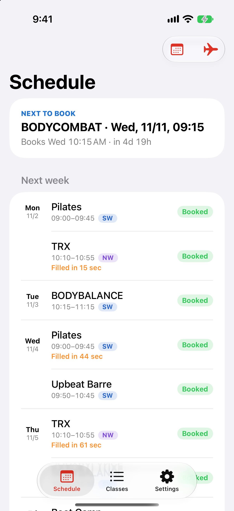
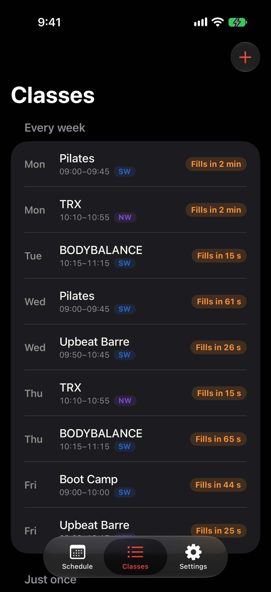
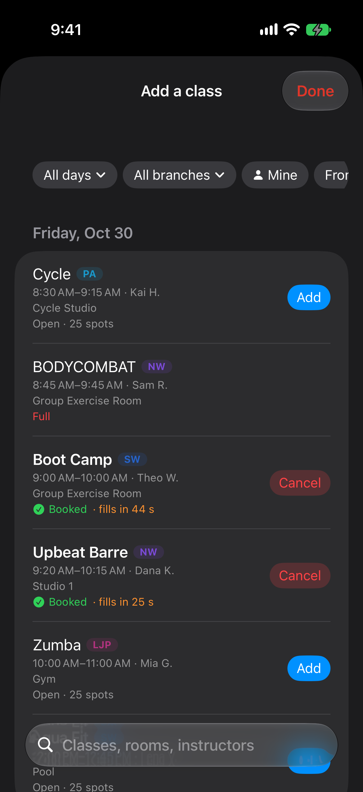
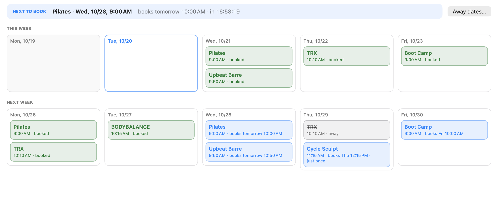
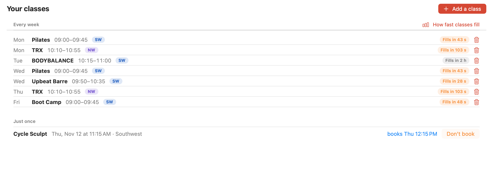
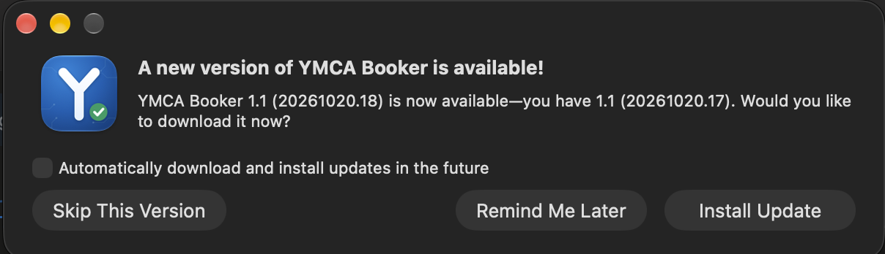

# YMCA Booker

**Never miss your favorite YMCA class again.**

Popular classes at the YMCA of Silicon Valley fill up within a minute of opening, a
week ahead. YMCA Booker books them for you, every week, the second they open.

| Your schedule | Your classes | Add a class |
|:---:|:---:|:---:|
|  |  |  |

**On your Mac**, the same three tabs:

## What you need

- 💻 **A Mac that stays on.** It does the booking. A desktop Mac is best; a MacBook
  only books while it's open and awake.
- 📱 **An iPhone or iPad** (optional), to see your classes and get a notification after each booking.
- 🏋️ **Your YMCA login**, the one you use in the YMCA app.

## Get the app

- **Mac** (does the booking): [download the latest .dmg](https://github.com/thomashan1/ymca-autobook/releases/latest)
  and drag **YMCA Booker** into Applications. After that it updates itself through
  [Sparkle](https://sparkle-project.org): it offers each new version, checks it's genuinely
  ours, and never restarts while a class is opening.

  

- **iPhone / iPad** (optional, a beta through Apple's TestFlight): email
  **[thomashan@icloud.com](mailto:thomashan@icloud.com)** for the invite link. Install the
  free [TestFlight](https://apps.apple.com/app/testflight/id899247664) app, open the link,
  and tap **Install**. TestFlight keeps it up to date.

## Set it up

1. Open **YMCA Booker** on your Mac and **log in with your YMCA account**.
2. Pick the classes you want every week. That's it: each one books itself from now on.
3. On your iPhone or iPad, open **YMCA Booker** with the same iCloud account and
   allow notifications.

**Going away?** Tap **Away dates** in Schedule and those classes are skipped.
**Just once?** Add a class just once under **Classes → Add a class**, or swipe a class in Schedule to skip it.

## Good to know

- **Keep the Mac awake.** Plug it in and turn on System Settings → Energy →
  *Prevent automatic sleeping*. If it's asleep when a class opens, that class isn't booked.
- **Your info stays yours.** Your login stays in your Mac's Keychain and your
  classes in your own iCloud. Nothing goes to anyone else.
- **All nine branches** of the YMCA of Silicon Valley are supported.
- **One Mac books.** On a second Mac, turn on **Don't book on this Mac** (Settings → This
  Mac) before signing in: it shows everything without booking.

---

More about the app: [`app/README.md`](app/README.md) ·
No Mac? There's a do-it-yourself version that runs on GitHub, for technical users:
[GitHub setup](docs/option-b-github.md)

_Screenshots use made-up classes; the fill speeds are real._
