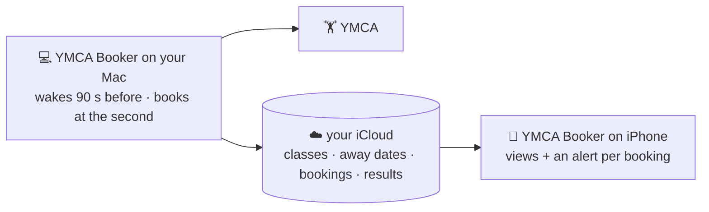
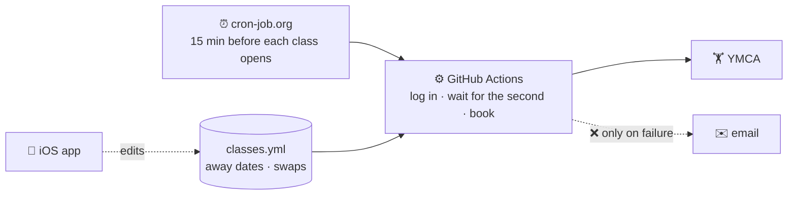

# ymca-autobook

Automatically books recurring Silicon Valley YMCA classes the second they open.

Each class opens for booking **167 hours before it starts**, i.e. a week ahead, one
hour after the class time (a Thursday 10:15 class opens the prior Thursday at 11:15).
The booker logs in just before, waits for that exact second, and books it.

## Two ways to run it

### A. Mac + iPhone (recommended)

**For anyone with a Mac that can stay on.** The **YMCA Booker** app on your Mac does the
booking; the same app on your iPhone or iPad shows your schedule and booking results.

- **You need:** a Mac that stays on and awake, ideally a **desktop** (iMac, Mac mini,
  Mac Studio). A MacBook works only while it's open, awake and online. Close the lid
  when a booking window opens and that class isn't booked. Also: an iCloud account
  and your YMCA (egym) login.
- **You don't need anything from GitHub:** no GitHub account, no repo, no token, no
  cron-job.org. Your classes and away dates live in the app and your own iCloud.

[Set up Option A ↓](#option-a-mac--iphone)

### B. GitHub (advanced)

**For people comfortable running their own GitHub setup**, or with no Mac that can stay
on. GitHub Actions does the booking in the cloud, started on time by cron-job.org.

- **You need:** a GitHub account with this code and a private repo, a GitHub token,
  repo secrets, cron-job.org jobs and your YMCA login.
- **Nothing runs at home,** and you can check it from any device.

[Set up Option B ↓](#option-b-github-advanced)

### Side by side

| | **Option A: Mac + iPhone** | **Option B: GitHub (advanced)** |
|---|---|---|
| Who books | **YMCA Booker** on your Mac | GitHub Actions, started by cron-job.org |
| Your data | Your own iCloud | Files in a private GitHub repo |
| Accounts | iCloud, the YMCA | GitHub, cron-job.org, the YMCA |
| GitHub needed? | **No** | Yes |
| Setup | Install the app and log in | Repos, secrets, a token and cron jobs |
| Needs | A Mac that's on and awake (a desktop is best) | Nothing running at home |
| Works on | Apple only: a Mac, plus an iPhone or iPad to view | Any device (it's all in the cloud) |

**Both at once (optional):** if you run Option A and also want Option B as a backup for
when the Mac is asleep or offline, turn on **Settings → Advanced → GitHub backup** on
the Mac. The Mac stays the main booker and writes a copy of your classes and away
dates to your private repo; GitHub books a class only if the Mac didn't get it within
5 seconds of the opening. Most people won't need this.

## 📱 iOS app

**YMCA Booker** on an iPhone or iPad shows your schedule ([`app/`](app/) is one app for Mac, iPhone and iPad). It reads
from your Mac (Option A) out of the box. For Option B, turn on **Settings → Advanced →
Use GitHub instead**. It doesn't book anything itself. See [`app/README.md`](app/README.md).

| Week | Classes | Book | Openings | Away |
|:---:|:---:|:---:|:---:|:---:|
|  |  |  |  |  |

- **Week**: two weeks of classes; green ✓ means actually booked.
- **Classes**: your weekly lineup as a calendar and a list, with how fast each class fills.
- **Book**: every upcoming class at all nine YMCA of Silicon Valley branches. Book or
  cancel any one; filter by day, branches (pick any number), start time, and hide pool
  or paid classes.
- **Openings**: countdowns to each booking window, the Mac's status and each booking
  result (with GitHub, a **Book now** swipe instead).
- **Away**: away dates (add, edit, delete) and one-off swaps.

### Fill speed

| Mine | Fill fast |
|:---:|:---:|
|  |  |

How long every class at every branch takes to fill once booking opens, over the
last 12 weeks. BODYPUMP fills in ~37 seconds every week; most classes take hours or
never fill.

_Screenshots use a made-up lineup and sample data; the Fill speed numbers are real (10/10)._

## Option A: Mac + iPhone

**YMCA Booker** is one app for Mac, iPhone and iPad, sharing your iCloud: on the
Mac it does the booking, and on the iPhone or iPad it shows it. It's in [`app/`](app/).

### Setting it up

1. **On the Mac:** install **YMCA Booker** and sign in to iCloud in System Settings.
2. In its Settings, **log in with your YMCA (egym) account**.
3. Under **Browse**, add your classes. Each one books every week from then on.
4. **On the iPhone or iPad:** install **YMCA Booker**, signed in to the **same iCloud
   account**, and allow notifications.

That's it. There's no GitHub, no cron-job.org and no token. Add away dates under
**Away & swaps**, and skip or book a single session under **Book**.

### How it works



- The Mac plans every 3 hours, wakes just before each window opens, and books at
  the exact second.
- It publishes your lineup, away dates, real bookings and each result to your
  private iCloud database. The phone reads them and sends an alert for each result.
- **The Mac has to be on and awake** when a window opens. If it's asleep, off, or
  a laptop with its lid closed, that class isn't booked. A desktop Mac is the best
  fit: keep it plugged in and set it not to sleep (System Settings → Energy →
  prevent automatic sleeping). The app keeps the Mac from idle-sleeping while it runs.

### Not done yet (tracked in [#146](https://github.com/thomashan1/ymca-autobook/issues/146))

- **Editing away dates and classes from the iPhone** (the Mac can already)
  ([#148](https://github.com/thomashan1/ymca-autobook/issues/148)). Option A needs
  no GitHub; running Option B as a backup is optional (Mac Settings → Advanced).
- **First-run setup** (choosing your branches) is
  [#150](https://github.com/thomashan1/ymca-autobook/issues/150).
- **A download** (a signed Mac app, plus TestFlight for the iPhone) is
  [#151](https://github.com/thomashan1/ymca-autobook/issues/151). Until then, the app is
  built from source in Xcode.

## Option B: GitHub (advanced)

No Mac needed: GitHub Actions does the booking, and your plan lives in files in a
private repo. (Running it as a backup to Option A? Then don't edit these files: the
Mac writes them.)

### How it works



1. **cron-job.org** starts a GitHub Actions run shortly before each class's window opens.
2. The run **logs in**, finds the class, and skips it if you're away that day.
3. It **waits** for the exact opening second and **books**.
4. You get an **email only if something goes wrong**.

The full diagrams and the reasoning behind them are in
[`docs/architecture.md`](docs/architecture.md).

### Your classes, away dates and swaps

All three live in a separate **private** repo, so they never appear here.

- **`classes.yml`**: the classes to book every week ([example](classes.example.yml)):

```yaml
classes:
  - key: vinyasa-yoga-mon     # short unique name
    name: "Vinyasa Yoga"      # exact title on the YMCA schedule
    weekday: Mon
    start: "10:15"
    location_ids: [1392]      # Southwest = 1392, Northwest = 1388
```

- **`away.yml`**: dates to skip, optionally keeping specific classes
  ([example](away.example.yml)).
- **`swaps.yml`**: on one date, take a different class instead of a recurring one
  ([example](swaps.example.yml)). Your original class is only cancelled once the
  replacement is actually booked.

### Setup

```bash
/usr/bin/python3 -m venv .venv
.venv/bin/python -m pip install -r requirements.txt
cp .env.example .env      # your egym login
```

GitHub Actions secrets: `EGYM_USERNAME`, `EGYM_PASSWORD`, `PRIVATE_REPO_TOKEN`
(reads `classes.yml`, away dates and swaps from your private repo), plus optional
`NOTIFY_EMAIL` / `GMAIL_APP_PASSWORD` (emails). Create the cron-job.org triggers with `./scripts/setup_cronjob_org.sh`.

Handy commands (`.venv/bin/python -m src.main …`):

```bash
--browse                  # what's on at both branches
--class <key> --dry-run   # find a class and its open time without booking
--book-id <id>            # book one specific class
--cancel-id <id>          # cancel a booking
```

Secrets stay in `.env` (git-ignored) and GitHub secrets, never in the repo.
