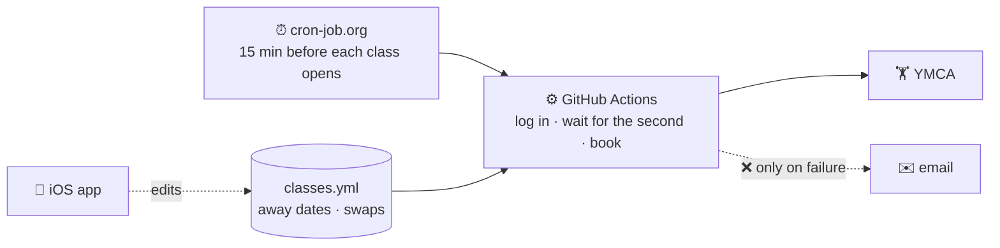

# Option B: GitHub (advanced)

Back to the [main README](../README.md) (Option A, the Mac app).

No Mac needed: GitHub Actions does the booking, and your plan lives in files in a
private repo. This is the do-it-yourself route: you run your own copy, under your own
accounts, and nothing goes through anyone else. (Running it as a backup to Option A?
Then don't edit these files: the Mac writes them.)

## Running both

If you run Option A and want GitHub as a backup for when the Mac is asleep or offline,
set this up and then turn on **Settings → General → For technical users → Also keep a GitHub backup** on the Mac. The
Mac stays the main booker and writes your classes, away dates and swaps into
`ymca-private`; GitHub books a class only if the Mac didn't get it within 5 seconds
of the opening.

## How it works



1. **cron-job.org** starts a GitHub Actions run shortly before each class's window opens.
2. The run **logs in**, finds the class, and skips it if you're away that day.
3. It **waits** for the exact opening second and **books**.
4. You get an **email only if something goes wrong**.

The full diagrams and the reasoning behind them are in
[`docs/architecture.md`](architecture.md).

## What you need

Everything below is free. "You" means the person running their own copy.

**Accounts**

| | What for | Required? |
|---|---|---|
| **YMCA of Silicon Valley membership** with an egym login (email + password) | The login the booker uses. Only the Silicon Valley YMCA works: the login and the branch ids are specific to it. | Yes |
| **GitHub account** | Holds the code and your private plan, and runs the bookings (GitHub Actions). | Yes |
| **[cron-job.org](https://cron-job.org) account** | Starts each booking run on time. GitHub's own `schedule:` trigger has been hours late since 2026-08, so it's switched off here. | Yes |
| **Gmail account with an [app password](https://myaccount.google.com/apppasswords)** (needs 2-Step Verification) | Failure alerts and the Mon / Wed / Fri summary emails. | No: without it you just get no emails |

**Two repos in your GitHub account**

| Repo | What's in it | Visibility |
|---|---|---|
| **A copy of this repo** (fork it; keep the name `ymca-autobook`) | The code and the workflows. Nothing personal. | Public is best: Actions minutes are free and unlimited for public repos. Each booking run waits about 15 min for its window, so a private copy uses roughly 700 of its 2,000 free minutes a month for 11 classes. |
| **`ymca-private`** (must be this name, same account) | `classes.yml`, `away.yml`, `swaps.yml`, plus files the workflows write back (`schedule_snapshot.json`, `bookings.json`, fill history). | **Private.** It holds your schedule. |

The code finds `ymca-private` under the same account as the code repo, so there's
nothing to edit. To use another name, set `PRIVATE_REPO` (`owner/name`) in the workflows' `env:`.

**Tokens** (fine-grained personal access tokens: GitHub → Settings → Developer settings
→ Fine-grained tokens)

| Token | Repository access | Permissions | Where it goes |
|---|---|---|---|
| **`PRIVATE_REPO_TOKEN`** | `ymca-private` only | Contents: **Read and write** (the workflows write snapshots back) | A repo secret in your code repo |
| **`GITHUB_PAT`** (for cron-job.org) | Your code repo only | Actions: **Read and write** (nothing else) | Your local `.env`; the setup script copies it into each cron-job.org job |
| iPhone app token (optional) | Both repos | Contents, Pull requests, Actions, Workflows: all **Read and write** | Pasted into the app; kept in the phone's Keychain |

Fine-grained tokens expire (GitHub emails you first). When one lapses, make a new one
and replace it where it goes.

**Repo secrets** (code repo → Settings → Secrets and variables → Actions)

| Secret | Value | Required? |
|---|---|---|
| `EGYM_USERNAME` | Your egym email | Yes |
| `EGYM_PASSWORD` | Your egym password | Yes |
| `PRIVATE_REPO_TOKEN` | The token above | Yes |
| `NOTIFY_EMAIL` | The Gmail address emails are sent from and to | No |
| `GMAIL_APP_PASSWORD` | That account's 16-character app password | No |

**On your own computer** (only for setup and changes; nothing runs there day to day)

- **git** and **Python 3.12** (the version the workflows use), with
  `httpx` and `pyyaml` from [`requirements.txt`](../requirements.txt).
- **bash** and **curl**, for `scripts/setup_cronjob_org.sh`.
- A **`.env`** file in the repo root (git-ignored; copy [`.env.example`](../.env.example)):
  `EGYM_USERNAME`, `EGYM_PASSWORD` for local runs, plus `CRONJOB_ORG_API_KEY`
  (cron-job.org → Settings → API) and `GITHUB_PAT` for the setup script.
- Optional: the [GitHub CLI](https://cli.github.com) (`gh`), handy for copying
  `classes.yml` down from the private repo.

**The iPhone app (optional).** In GitHub mode (Settings → Advanced → Use GitHub instead)
it shows and edits your plan and can start a booking; GitHub still does the booking.
There's no download yet, so building it needs a Mac with **Xcode** and your own Apple
developer team. In Xcode, change the bundle id and the iCloud container to your own.
It reads the GitHub account from your token, so there's nothing else to change.

## Your classes, away dates and swaps

All three live in `ymca-private`, so they never appear in the public repo.

- **`classes.yml`**: the classes to book every week ([example](../classes.example.yml)):

```yaml
timezone: America/Los_Angeles
classes:
  - key: vinyasa-yoga-mon     # short unique name
    name: "Vinyasa Yoga"      # exact title on the YMCA schedule
    weekday: Mon
    start: "10:15"
    location_ids: [1392]      # the branch (ids below)
```

- **`away.yml`**: dates to skip, optionally keeping specific classes
  ([example](../away.example.yml)).
- **`swaps.yml`**: on one date, take a different class instead of a recurring one
  ([example](../swaps.example.yml)). Your original class is only cancelled once the
  replacement is actually booked.

**Branch ids** (also in [`src/branches.py`](../src/branches.py)):

| id | Branch | id | Branch | id | Branch |
|---|---|---|---|---|---|
| 1384 | Central | 1387 | East Valley | 1390 | Sequoia |
| 1385 | El Camino | 1388 | Northwest | 1391 | South Valley |
| 1386 | Lewis and Joan Platt | 1389 | Palo Alto | 1392 | Southwest |

## Setup, step by step

1. **Fork this repo** into your account. In the fork's **Actions** tab, click to enable
   workflows (forks start with them off).
2. **Create the private repo** `ymca-private` and add `classes.yml`, `away.yml` (can be
   just `away: []`) and `swaps.yml` (`swaps: []`), using the examples as templates.
3. **Make the tokens** and **add the repo secrets** (tables above).
4. **On your computer**, clone your fork and set it up:

   ```bash
   python3.12 -m venv .venv
   .venv/bin/python -m pip install -r requirements.txt
   cp .env.example .env      # then fill in your egym login and the two setup-script values
   ```

5. **Check your classes match the YMCA schedule** (books nothing):

   ```bash
   .venv/bin/python -m src.main --list "BODYPUMP"        # exact names, times, branches
   .venv/bin/python -m src.main --class <key> --dry-run  # finds the class and its open time
   ```

   Without `PRIVATE_REPO_TOKEN` in your environment these read a local `classes.yml`;
   copy yours down with
   `gh api repos/<you>/ymca-private/contents/classes.yml -H "Accept: application/vnd.github.raw" > classes.yml`.
6. **Create the cron-job.org triggers**: `./scripts/setup_cronjob_org.sh` (reads the
   local `classes.yml`). It makes one job per class, 15 min before each window opens
   (two for classes with `extra_leads`), plus a `swap-check` job for swaps.
7. **Test one run**: in your fork, Actions → *Book YMCA classes* → Run workflow, with
   `browse` set to `all`. It logs in and lists classes without booking.

**When you change your classes later:** edit `classes.yml` in `ymca-private`, copy it
down, delete that class's jobs in the cron-job.org console, and re-run the setup script
(it skips jobs that already exist). Away dates and swaps need no extra step.

**Things to know**

- **GitHub turns off scheduled workflows after 60 days with no commits** to a public
  repo, and emails you. Booking isn't affected (it's started by cron-job.org), but the
  summary emails and snapshots are. Re-enable them in the Actions tab.
- **cron-job.org is the only clock.** If it has a bad day, nothing else starts the
  booking. Option A's Mac with Option B as its backup covers that.
- **Secrets stay in `.env` (git-ignored), GitHub secrets and cron-job.org**, never in
  the repo.

## Handy commands

`.venv/bin/python -m src.main …`

```bash
--list [name]             # what's on at every branch (or your list_location_ids)
--class <key> --dry-run   # find a class and its open time without booking
--book-id <id>            # book one specific class
--cancel-id <id>          # cancel a booking
--cancel-away             # cancel bookings that now fall on away dates
```
